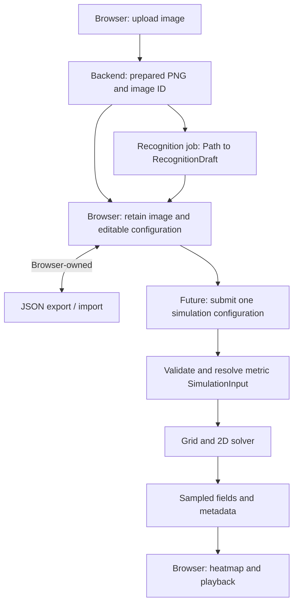

# Aromap backend

FastAPI processes operation-specific inputs. The browser owns editable projects,
local persistence, save-format versions, and JSON export/import. There is no backend
`ProjectDocument` or project CRUD API. SQLite tracks temporary uploads and jobs;
images and recognition results live on the same local volume.

## Run

From `backend/`:

```sh
uv sync --locked
uv run uvicorn app.main:app --reload
uv run pytest -q
```

Use **one API process**. The local queue is not shared across API replicas/workers.
Recognition runs in one spawned child process, with up to four waiting jobs.
The backend service can also run from the repository root:

```sh
docker compose up --build backend
```

The default Compose target installs development dependencies and enables reload
for mounted `app/` source. Run tests in that environment with:

```sh
docker compose run --rm --no-deps backend uv run --locked pytest -q
```

For production-style staging without reload, development dependencies, or source
mounts:

```sh
docker compose -p aromap-staging -f compose.yaml -f compose.staging.yaml up --build backend
```

Both modes publish `${BACKEND_PORT:-8000}` on `${HOST_BIND:-127.0.0.1}`. Swagger
remains directly accessible on that host port. `/health` returns `{"status":"ok"}`
after initialization and checks SQLite connectivity; it does not require a
recognition provider. Compose uses this endpoint for backend readiness.

Compose mounts `backend-data` at `/data`, retaining SQLite and files across container
recreation. Staging's separate project name gives it a separate volume. Running
`down -v` with the corresponding Compose/project arguments deletes that volume. API documentation and
schemas are at `/docs` and `/openapi.json`.

Recognition is unavailable by default. The entry point now delegates to an OpenCV
implementation; enable it with
`AROMAP_RECOGNITION_CALLABLE=app.floor_plans.recognition.interface:recognize_floor_plan`
and restart. No mock recognition is served by production endpoints.

## Configuration

Environment variables (or `Settings` in tests):

For Compose, these can be set in the repository root `.env` (the data directory
remains `/data`); see root `.env.example`. A blank CORS setting in Compose derives
localhost/127.0.0.1 origins from `FRONTEND_PORT`. For local uv execution, export
settings in the shell; `.env` is not
automatically loaded by the application.

| Variable | Default | Meaning |
| --- | --- | --- |
| `AROMAP_DATA_DIR` | `.data` relative to working directory | SQLite, uploads, results; `/data` in Compose |
| `AROMAP_CORS_ORIGINS` | `http://localhost:5173` | Comma-separated allowed frontend origins |
| `AROMAP_MAX_UPLOAD_BYTES` | `10485760` | 10 MiB per image |
| `AROMAP_MAX_IMAGE_PIXELS` | `20000000` | Maximum decoded width × height |
| `AROMAP_RETENTION_SECONDS` | `86400` | Upload retention and terminal-job/result retention |
| `AROMAP_CLEANUP_INTERVAL_SECONDS` | `60` | Periodic expired-resource cleanup |
| `AROMAP_QUEUE_CAPACITY` | `4` | Waiting recognitions, in addition to one running job |
| `AROMAP_RECOGNITION_CALLABLE` | unset | Operator-configured importable recognition function |

The storage root contains `registry.sqlite3`, `uploads/<image_id>/image.png`, and
`results/<job_id>.json`. Public IDs are randomly generated; client filenames never
choose filesystem locations. No login is required: anyone holding a resource ID
can access it until expiry. These endpoints are temporary resources, not cloud saves.

## Frontend contract

### Upload

`POST /api/floor-plans/uploads`, `multipart/form-data`, field **`image`**.
Accept PNG, JPEG, or WebP; reject animation. Validate actual decoded format rather
than trusting the filename or declared MIME type. Normalize EXIF orientation,
strip metadata, and return a prepared PNG without resizing. The dimensions and all
recognized coordinates refer to this prepared image, not the original file.

```javascript
const body = new FormData();
body.append("image", file);
const response = await fetch(`${apiBase}/api/floor-plans/uploads`, {
  method: "POST", body,
}); // Let the browser set Content-Type and its multipart boundary.
if (!response.ok) throw await response.json();
const uploaded = await response.json();
```

`201 Created`:

```json
{
  "image_id": "opaque-image-id",
  "image_url": "/api/floor-plans/uploads/opaque-image-id/image",
  "width_px": 1600,
  "height_px": 1000,
  "media_type": "image/png",
  "expires_at": "2026-11-01T09:00:00Z"
}
```

`GET /api/floor-plans/uploads/{image_id}/image` returns PNG bytes with
`Cache-Control: no-store`. Resolve returned paths against the backend origin when
FE and BE use different origins. The frontend should retain the prepared image in
IndexedDB for editing/export, rather than depend on an expiring URL. Upload success
does not start recognition.

The file-byte and pixel limits are independent. The total multipart request is
also bounded to the file limit plus 1 MiB of envelope overhead, including chunked
requests. Missing/wrong fields return the standard validation error below.

### Recognition

`POST /api/floor-plans/recognitions`, JSON:

```json
{ "image_id": "opaque-image-id" }
```

`202 Accepted` (only when a provider is enabled):

```json
{
  "job_id": "opaque-job-id",
  "status_url": "/api/floor-plans/recognitions/opaque-job-id"
}
```

Until provider integration, this returns **503 `recognition_unavailable`** and
creates no job. Queue saturation returns **429 `queue_full`**; retry later.

`GET /api/floor-plans/recognitions/{job_id}` returns `200` with status and an inline,
typed result. Poll roughly once per second and stop at a terminal state.

```json
{
  "job_id": "opaque-job-id",
  "state": "succeeded",
  "created_at": "2026-10-31T09:00:00Z",
  "updated_at": "2026-10-31T09:00:02Z",
  "expires_at": "2026-11-01T09:00:02Z",
  "result": {
    "floor_plan": {
      "layout": {
        "id": "recognized-layout-id",
        "revision": 1,
        "width_px": 1600,
        "height_px": 1000,
        "walls": [],
        "doors": [],
        "windows": [],
        "room_labels": [],
        "calibration": null
      },
      "reference_image": null
    },
    "warnings": ["Example of an empty detection; manual correction needed."]
  },
  "error": null
}
```

States: `queued → running → succeeded / failed`. `result` is null except on success;
`error` is null except on failure, when it contains `{ "code": "...", "message": "..." }`.
A processing failure is a successfully retrieved job status (`200`, `state=failed`),
not an HTTP 500. The example above illustrates the schema, not actual recognition.

Frontend associates a job with its submitted image, attaches the locally retained
reference image to returned geometry, and asks before replacing existing edits.
Recognition does not return opening states or calibration. Upload/job IDs stay in
runtime state, outside portable frontend saves.

### Errors

```json
{ "detail": { "code": "invalid_image", "message": "The image could not be decoded or prepared." } }
```

| HTTP status | Codes / meaning |
| --- | --- |
| 404 | `image_not_found`, `job_not_found`: unknown or expired resource |
| 413 | `image_too_large`: bytes, pixels, or request envelope exceeds limits |
| 415 | `unsupported_image`, `animated_image` |
| 422 | `invalid_image`, `invalid_request` |
| 429 | `queue_full` |
| 503 | `recognition_unavailable` |
| 500 | `result_unavailable`, `internal_error` |

Provider exceptions are logged server-side; jobs expose a generic
`recognition_failed` error without paths or exception details. Invalid request
fields use the same error envelope, including FastAPI validation failures.

## Jobs, expiry, and restart behavior

Currently only recognition jobs are submitted. Uploads and image retrieval are
not jobs. Simulation can reuse lifecycle infrastructure later; no simulation or
advice endpoint is implemented yet.

SQLite stores upload metadata and job kind/state, input image reference,
creation/update/expiry timestamps, result reference, and error details. It never
stores user projects or image bytes. Database transactions finish before computation.

The queue is bounded and in memory, not a durable broker. Shutdown/startup marks
unfinished jobs `failed` with `job_interrupted`; there are no automatic retries or
resumption. Graceful shutdown waits for an executing child process to finish, but
may discard its result and mark the job interrupted. A provider that hangs requires
operator intervention; hard execution timeouts are not implemented yet.

Uploads expire 24 hours after creation by default. Jobs receive a fresh retention
window at completion. Active jobs remain pollable past their provisional expiry;
cleanup never removes their inputs. Files/metadata are retained internally while
referenced by a surviving job even if the public upload URL has expired. Terminal
jobs/results and unreferenced expired uploads are removed on startup and periodically.
A successful browser save must not depend on any of these temporary resources.

## Modules and models

| Package | Owns | Contracts |
| --- | --- | --- |
| `floor_plans` | Image endpoints, preparation, recognition orchestration | `UploadedImage`, recognition DTOs, `RecognitionDraft`, `Layout` |
| `floor_plans/recognition` | Image-to-editable-geometry implementation | Existing `Path → RecognitionDraft` boundary |
| `diffusers` | Relative emission definitions and future examples | `DiffuserDefinition` |
| `simulations` | Submitted configuration, metric preparation, engine/results | `SimulationConfiguration`, `SimulationInput`, `SimulationResult` |
| `advice` | Future on-demand interpretation | `AdviceRequest.configuration`, `AdviceResponse` |
| `infrastructure` | Local storage, SQLite, job execution, upload-body limit | Operational resources, not project ownership |

Placements, opening states, conditions, and simulation settings now live in
`simulations/models.py`. `Scenario` is replaced by `SimulationConfiguration`, which
has no saved-scenario ID/name. The browser can compose these API data shapes into
its own versioned project format; the backend has no import/export migrations.
`FloorPlan`/`ReferenceImage` remain for compatibility with the handed-off recognition
contract, but recognition returns `reference_image=None`.

## Recognition handoff contract

The authoritative callable and error contract remain in
[`interface.py`](app/floor_plans/recognition/interface.py), and output models in
[`models.py`](app/floor_plans/models.py):

```python
recognize_floor_plan(image_path: Path) -> RecognitionDraft
```

It delegates to the OpenCV pipeline in
[`pipeline.py`](app/floor_plans/recognition/pipeline.py), which detects axis-aligned
walls (solid or hollow line-drawn) and identifies doors and windows from wall gaps,
swing arcs, and glazing lines. Other providers should live in sibling modules
behind the same entry point.

- Caller supplies an absolute path to a prepared image, retains it throughout the
  call, and owns storage/cleanup. Recognition must not modify/delete the original.
- Recognizer generates layout/geometry IDs and returns revision `1`, matching image
  dimensions, `reference_image=None`, and `calibration=None`.
- Internal resizing/rotation must map back to input image coordinates: top-left
  origin, x rightward, y downward.
- Walls are nonzero, zero-thickness segments split at every crossing and T-junction.
  An X produces four segments; a T produces three. Connected segments share exact
  endpoint coordinates, with no junction inside a returned segment.
- Parent walls span their door/window openings. Each opening lies along and
  references one final wall segment. Omit ambiguous openings with a warning rather
  than emitting dangling references.
- Wall IDs are unique within walls. Opening IDs are unique across doors/windows.
  Frontend preserves IDs for surviving features; repeated recognition need not
  reproduce the same IDs.
- Return partial/empty geometry with warnings for incomplete/no detection. Raise
  `RecognitionError` for unreadable images or processing failures.
- Do not infer operating states, A/C/fans, airflow, or simulation grids.

The executor checks basic output structure, dimensions, revision, and unset
calibration/reference image. Full geometry/topology validation remains follow-up
work; the model declarations do not enforce it yet.

## Coordinates and future simulation flow

`PixelPoint` is used for editable geometry, calibration endpoints, and placements.
`MetricPoint` is used for resolved solver geometry and sources. Both serialize as
`{ "x": ..., "y": ... }`; containing schemas define their units.

Preparation will reject absent/zero-length calibration and convert uniformly:

```text
meters_per_pixel = distance_m / hypot(end.x - start.x, end.y - start.y)
x_m = x_px * meters_per_pixel
y_m = y_px * meters_per_pixel
```

Apply scale to all geometry, positions, and layout dimensions before invoking the
engine. Metric coordinates retain the same axis directions. Grid cell size is in
meters and independent of image resolution. Display zoom/pan changes no stored
geometry; resampling the underlying image must transform calibration/geometry too.
Perspective images require rectification before a uniform scale is meaningful.



Future simulation requests carry a layout/calibration, definitions, placements,
opening states, conditions, and settings for one configuration. They omit image
bytes and inactive scenarios. Preparation validates references, resolves omitted
opening states to closed, and records explicit assumptions in a detached input.
Open doors connect spaces; windows are recognized now but open-window physical
behavior is still undecided. No preparation/solver implementation is included yet.

Before frontend heatmap work, agree on result grid origin, dimensions, row/column
order, blocked-cell encoding, sample times, concentration units, field format, and
correlation with submitted edits. Advice similarly accepts explicit configuration
context, not the browser's project document.

Results will represent approximate relative concentrations under stated assumptions,
not accurate real airflow or perceived scent intensity. Test the future engine
independently of recognition using predefined layouts under `tests/fixtures/layouts/`.
