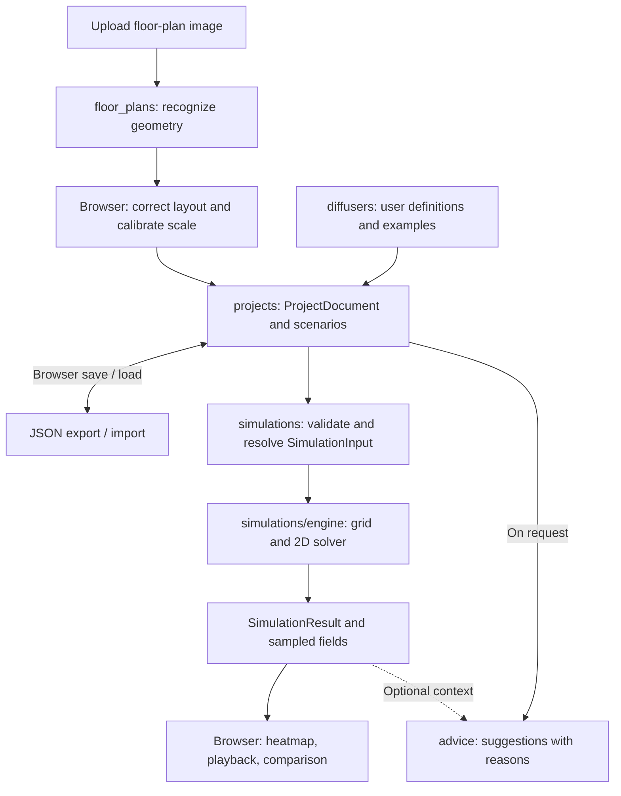

# Aromap backend

FastAPI backend with domain packages. This is groundwork: models are draft
contracts, not a finished API or simulation implementation. No domain endpoints,
recognition provider, solver, job runner, storage provider, or AI provider exist yet.

## Local development

Use Python 3.12+ and uv from this directory:

```sh
uv sync --locked
uv run uvicorn app.main:app --reload
```

The root Compose configuration also builds this service. FastAPI's generated
documentation is available at `/docs`; no domain routes are registered yet.

## Modules and dependencies

| Package | Owns | Main models |
| --- | --- | --- |
| `floor_plans` | Uploaded reference image, editable geometry, calibration, recognition draft | `FloorPlan`, `Layout`, `Wall`, `DoorOpening`, `ScaleCalibration`, `RecognitionDraft` |
| `diffusers` | User definitions, future example profiles, emission assumptions | `DiffuserDefinition`, `RelativeEmissionProfile` |
| `projects` | Portable document, scenario editing contracts, future schema migrations | `ProjectDocument`, `Scenario`, `DiffuserPlacement`, `EnvironmentalConditions`, `SimulationSettings` |
| `simulations` | Resolve inputs, prepare grid, run model, describe results | `SimulationInput`, `SimulationGeometry`, `EmissionSource`, `SimulationResult` |
| `advice` | On-demand suggestions referring to explicit project/scenario state | `AdviceRequest`, `Suggestion`, `AdviceResponse` |
| `infrastructure` | Future temporary artifact storage and process execution | `JobStatus` |

`projects` composes floor-plan and diffuser models. `advice` accepts a project
snapshot. Simulation preparation will translate projects into resolved simulation
inputs; the engine must not depend on the project document, FastAPI, database
sessions, or artifact storage. Geometry primitives are currently shared through
`floor_plans`. Infrastructure executes domain work without owning its rules.

Keep future routers, request/response schemas, services, and repositories inside
their owning domain as needed. No global layer directories or generic repository
framework are required. `recognition/` and `simulations/engine/` reserve implementation
boundaries; provider interfaces should follow concrete integration needs.

## Document and model relationships

```text
ProjectDocument (schema_version)
  floor_plan
    reference_image (optional, embedded)
    layout (id, revision)
      walls / doors / optional room labels
      optional scale calibration
  diffuser_definitions[]
  scenarios[]
    placements[] -> diffuser definition IDs
    environmental conditions
    simulation settings
  active_scenario_id -> scenario ID
```

A definition describes a diffuser; a placement is one instance with a position,
optional strength override, and enabled state. Example and user profiles will
resolve through the same path. Initial emission profiles are constant and relative;
example values and scientific defaults have intentionally not been chosen.

All scenarios currently share the project's current layout and definitions. A
layout edit therefore affects future runs of every scenario. Past runs retain a
complete resolved snapshot. Independent layouts per scenario can be added later
if comparisons require them.

Editable geometry uses image pixels with a top-left origin, x rightward and y
downward. Calibration maps a nonzero pixel segment to a distance in meters.
Draft layouts may be uncalibrated; simulation preparation must reject them.
Doors reference a wall and describe an opening segment along it. Closed doors
leave the wall impermeable; open doors become connections. Room labels are
annotations, not connectivity definitions.

Resolved `SimulationGeometry` uses meters with the same axis directions. Its
open doorways reference wall indices. The computational grid is derived data,
never the editable source of truth. Its mask, indexing, and field artifact format
remain to be designed together with the solver.

Models currently enforce basic types and scalar ranges only. Services must later
validate unique IDs, references, finite numeric values, calibration, wall/door
topology, traversable source positions, compatible sample settings, and resource
limits. Successful model construction does not mean a project is simulation-ready.

## Planned pipeline



Recognition and diffuser entry can happen in parallel. Infrastructure supports
recognition and simulation with background jobs and temporary artifacts; saved
projects remain browser-owned. The chart describes the planned flow.

1. Upload an image and submit a recognition job. In parallel, the browser lets the
   user enter diffuser definitions or choose examples.
2. Recognition returns `RecognitionDraft`, including warnings. The user corrects
   walls and doors and calibrates the scale. Recognition does not create the final
   computational grid.
3. The browser maintains a `ProjectDocument`. Users create/delete/move placements
   and change scenario conditions in the interactive editor.
4. Simulation preparation validates the selected scenario, resolves enabled
   placements and strength multipliers into explicit emission rates, converts
   geometry to meters, and produces a detached `SimulationInput` snapshot.
5. Record its input fingerprint, solver version, explicit parameters, and assumptions.
   The fingerprint algorithm and canonical serialization remain to be selected.
   Treat this snapshot as immutable after submission; the current mutable Pydantic
   models do not enforce deep immutability.
6. A process runner builds a boundary-aware grid and executes a single 2D model:
   diffusion/effective mixing, source emission, and ventilation represented as
   removal. Walls block flux; open doors connect spaces. Numerical stability,
   time-step selection, and cost limits belong to preparation/engine code.
7. Store sampled fields as a temporary artifact. Return `SimulationResult` metadata
   with sample times, its input snapshot, artifact ID, and diagnostics. The initial
   contract assumes zero initial concentration and uniform removal/diffusivity;
   record these assumptions explicitly. A 2D areal concentration uses relative
   units per square meter, not a physical airborne concentration or scent rating.
8. The browser retrieves fields and controls heatmap playback, slider, and legend.
   Scrubbing time does not rerun the simulation. Compare scenarios using consistent
   color scales. Fingerprints identify results that no longer match current edits.
9. On explicit request, advice analyzes the selected project/scenario and optional
   run. Verify that a supplied run matches the analyzed input before interpreting
   it. Return reasons, limitations, and the input fingerprint with suggestions.

Recognition and simulation share the job lifecycle `queued -> running ->
succeeded / failed`, with domain-specific payloads and artifacts. HTTP handlers
should submit work rather than run CPU-heavy computation in the event loop.
Execution, status lookup, failure handling, artifact retrieval, and expiry are
planned behavior; `JobStatus` only describes the initial contract.

## Browser persistence and export

No accounts or durable server-side project storage are planned for the MVP.
The browser owns local persistence (preferably IndexedDB) and JSON export/import.
The backend validates incoming data before processing it.

Exports contain the versioned document and, when present, embedded reference image
data. They must remain usable after temporary backend uploads/results expire.
Large concentration arrays and temporary job/run references are excluded from the
default document; imported projects can rerun simulations. Future document format
changes should add explicit migrations and reject unsupported versions clearly.
Temporary storage needs a defined TTL and cleanup policy before deployment.

## Extensions and verification

Improved recognition stays in `floor_plans`; calibrated products stay in
`diffusers`. Furniture would extend geometry and obstacle preparation. Optimization
can become a separate domain that generates scenarios and calls the engine.
Room-specific targets can extend scenarios. Accounts/cloud saving can wrap the
portable document without making the solver depend on persistence.

Keep solver checks independent of recognition using `tests/fixtures/layouts/`.
Future checks should cover closed-wall isolation, open-door transport, conservation
without removal, expected decay with removal, source accounting, and resolution/
time-step behavior. API and job integration tests can follow their implementations.

Results represent approximate relative concentrations under stated assumptions.
Floor plans alone do not determine real airflow, product emission chemistry, or
perceived scent intensity.
