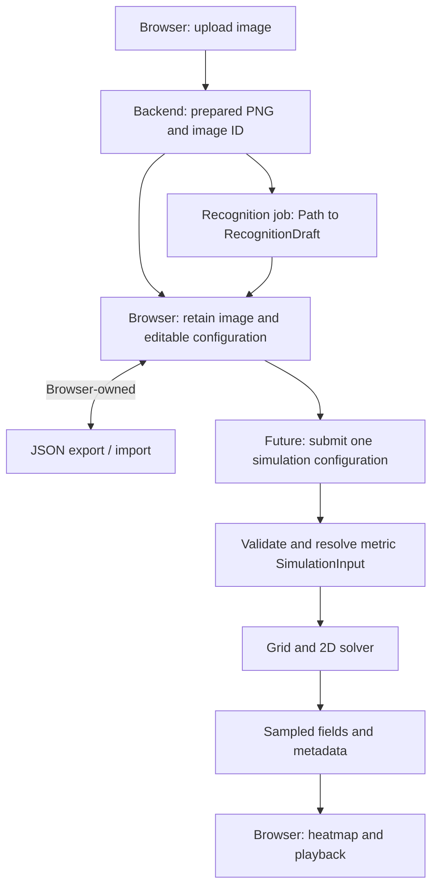

# Aromap backend

FastAPI processes operation-specific inputs. The browser owns editable projects,
local persistence, save-format versions, and JSON export/import. There is no backend
`ProjectDocument` or project CRUD API. SQLite tracks temporary uploads and jobs;
images and recognition results live on the same local volume.

## Browser data ownership (planning direction)

The frontend should persist editable work and prepared image Blobs locally
(IndexedDB is the suggested store), separately from temporary backend image/job
handles and cached results. Pixel geometry and user-entered calibration remain
the editing source of truth; FE can derive metric geometry when submitting work.
Exports should remain usable after backend resources expire.

Each operation receives only its relevant context: recognition uses an uploaded
image ID; future simulation/advice requests carry the selected configuration and
any needed result context, rather than the entire saved project. FE should associate
results with submitted snapshots to avoid applying stale results after edits.
The suggested logical save shape is frontend-owned, not a backend DTO:

```text
Project (schema_version, id, name)
  floor_plan
    prepared_image                   Blob locally, embedded for export
    geometry_px                      dimensions, walls, doors, windows, labels, indoor domain
    calibration                      pixel reference + known length in meters
  diffuser_definitions[]              consumer specifications and provenance
  scenarios[]
    id, name
    placements[]                     ID, definition ID, pixel position, overrides
    opening_states[]
    environmental settings
    simulation settings
  active_scenario_id
```

Backend handles, pending jobs, result arrays, and their submitted snapshots belong
to a separate runtime/cache store. They are not required in portable exports.
Keep pixel geometry/calibration authoritative; derive meters for each request.
Save-format details and advice DTOs remain open. The simulation HTTP contract is
defined below, with numerical defaults and artifact encoding still provisional.

## Run

From `backend/`:

```sh
uv sync --locked
uv run uvicorn app.main:app --reload
uv run pytest -q
```

Use **one API process**. The local queue is not shared across API replicas/workers.
Recognition runs in one spawned child process, with up to four waiting jobs.
The backend service can also run from the repository root:

```sh
docker compose up --build backend
```

The default Compose target installs development dependencies and enables reload
for mounted `app/` source. Run tests in that environment with:

```sh
docker compose run --rm --no-deps backend uv run --locked pytest -q
```

For production-style staging without reload, development dependencies, or source
mounts:

```sh
docker compose -p aromap-staging -f compose.yaml -f compose.staging.yaml up --build backend
```

Both modes publish `${BACKEND_PORT:-8000}` on `${HOST_BIND:-127.0.0.1}`. Swagger
remains directly accessible on that host port. `/health` returns `{"status":"ok"}`
after initialization and checks SQLite connectivity; it does not require a
recognition provider. Compose uses this endpoint for backend readiness.

Compose mounts `backend-data` at `/data`, retaining SQLite and files across container
recreation. Staging's separate project name gives it a separate volume. Running
`down -v` with the corresponding Compose/project arguments deletes that volume. API documentation and
schemas are at `/docs` and `/openapi.json`.

Recognition is unavailable by default. The entry point now delegates to an OpenCV
implementation; enable it with
`AROMAP_RECOGNITION_CALLABLE=app.floor_plans.recognition.interface:recognize_floor_plan`
and restart. No mock recognition is served by production endpoints.

## Configuration

Environment variables (or `Settings` in tests):

For Compose, these can be set in the repository root `.env` (the data directory
remains `/data`); see root `.env.example`. A blank CORS setting in Compose derives
localhost/127.0.0.1 origins from `FRONTEND_PORT`. For local uv execution, export
settings in the shell; `.env` is not
automatically loaded by the application.

| Variable | Default | Meaning |
| --- | --- | --- |
| `AROMAP_DATA_DIR` | `.data` relative to working directory | SQLite, uploads, results; `/data` in Compose |
| `AROMAP_CORS_ORIGINS` | `http://localhost:5173` | Comma-separated allowed frontend origins |
| `AROMAP_MAX_UPLOAD_BYTES` | `10485760` | 10 MiB per image |
| `AROMAP_MAX_IMAGE_PIXELS` | `20000000` | Maximum decoded width × height |
| `AROMAP_RETENTION_SECONDS` | `86400` | Upload retention and terminal-job/result retention |
| `AROMAP_CLEANUP_INTERVAL_SECONDS` | `60` | Periodic expired-resource cleanup |
| `AROMAP_QUEUE_CAPACITY` | `4` | Waiting recognitions, in addition to one running job |
| `AROMAP_RECOGNITION_CALLABLE` | unset | Operator-configured importable recognition function |

The storage root contains `registry.sqlite3`, `uploads/<image_id>/image.png`, and
`results/<job_id>.json`. Public IDs are randomly generated; client filenames never
choose filesystem locations. No login is required: anyone holding a resource ID
can access it until expiry. These endpoints are temporary resources, not cloud saves.

## Frontend contract

### API routing

Frontend application code should use relative `/api/...` URLs. The FE lead owns
Vite development proxying and Nginx staging proxying to `http://backend:8000`,
preserving the `/api` prefix. Compose supplies `API_PROXY_TARGET` for Vite to consume;
proxy configuration is not yet implemented in frontend files. Nginx must configure
its upstream separately; inheriting that variable does not configure Nginx.

The backend remains directly available on `BACKEND_PORT` for Swagger and API tools.
Host port changes do not change the internal upstream. Direct browser requests
from another origin use configured CORS; same-origin proxied requests need none.
Proxies must allow at least the configured file limit plus 1 MiB multipart overhead.
The returned image/status paths are relative to the API origin and work through
the same `/api` proxy. Without a proxy, resolve them against the backend origin.

### Upload

`POST /api/floor-plans/uploads`, `multipart/form-data`, field **`image`**.
Accept PNG, JPEG, or WebP; reject animation. Validate actual decoded format rather
than trusting the filename or declared MIME type. Normalize EXIF orientation,
strip metadata, and return a prepared PNG without resizing. The dimensions and all
recognized coordinates refer to this prepared image, not the original file.

```javascript
const body = new FormData();
body.append("image", file);
const response = await fetch('/api/floor-plans/uploads', {
  method: "POST", body,
}); // Let the browser set Content-Type and its multipart boundary.
if (!response.ok) throw await response.json();
const uploaded = await response.json();
```

`201 Created`:

```json
{
  "image_id": "opaque-image-id",
  "image_url": "/api/floor-plans/uploads/opaque-image-id/image",
  "width_px": 1600,
  "height_px": 1000,
  "media_type": "image/png",
  "expires_at": "2026-11-01T09:00:00Z"
}
```

`GET /api/floor-plans/uploads/{image_id}/image` returns PNG bytes with
`Cache-Control: no-store`. Resolve returned paths against the backend origin when
FE and BE use different origins. The frontend should retain the prepared image in
IndexedDB for editing/export, rather than depend on an expiring URL. Upload success
does not start recognition.

The file-byte and pixel limits are independent. The total multipart request is
also bounded to the file limit plus 1 MiB of envelope overhead, including chunked
requests. Missing/wrong fields return the standard validation error below.

### Recognition

`POST /api/floor-plans/recognitions`, JSON:

```json
{ "image_id": "opaque-image-id" }
```

`202 Accepted` (only when a provider is enabled):

```json
{
  "job_id": "opaque-job-id",
  "status_url": "/api/floor-plans/recognitions/opaque-job-id"
}
```

Until provider integration, this returns **503 `recognition_unavailable`** and
creates no job. Queue saturation returns **429 `queue_full`**; retry later.

`GET /api/floor-plans/recognitions/{job_id}` returns `200` with status and an inline,
typed result. Poll roughly once per second and stop at a terminal state.

```json
{
  "job_id": "opaque-job-id",
  "state": "succeeded",
  "created_at": "2026-10-31T09:00:00Z",
  "updated_at": "2026-10-31T09:00:02Z",
  "expires_at": "2026-11-01T09:00:02Z",
  "result": {
    "floor_plan": {
      "layout": {
        "id": "recognized-layout-id",
        "revision": 1,
        "width_px": 1600,
        "height_px": 1000,
        "walls": [],
        "doors": [],
        "windows": [],
        "room_labels": [],
        "indoor_domain": null,
        "calibration": null
      },
      "reference_image": null
    },
    "warnings": ["Example of an empty detection; manual correction needed."]
  },
  "error": null
}
```

States: `queued → running → succeeded / failed`. `result` is null except on success;
`error` is null except on failure, when it contains `{ "code": "...", "message": "..." }`.
A processing failure is a successfully retrieved job status (`200`, `state=failed`),
not an HTTP 500. The example above illustrates the schema, not actual recognition.

Frontend associates a job with its submitted image, attaches the locally retained
reference image to returned geometry, and asks before replacing existing edits.
Recognition does not infer opening states or calibration; the endpoint returns
`calibration: null` in the existing layout schema. Upload/job IDs stay in
runtime state, outside portable frontend saves.

`result.floor_plan.layout.indoor_domain` is an estimated **pixel-coordinate**
footprint for user review/correction, or `null` with a warning when unavailable.
Its shape is `{ "boundary": [PixelPoint, ...], "holes": [[PixelPoint, ...], ...] }`.
All indoor-domain vertex coordinates must be finite pixel values; NaN and infinity are rejected.
Each ring has at least three ordered vertices and closes implicitly; the outer
boundary may be concave (e.g. an L-shaped plan). Holes exclude areas such as outdoor
courtyards, not ordinary rooms or internal walls. Initially there is one outer
polygon; disconnected footprints and polygon topology validation remain future work.

This change adds the output contract only: the current recognizer does not estimate
the footprint yet, so it returns `null` and the worker adds a manual-tracing warning.
The recognition owner will implement estimation. FE lets users correct an estimate
or trace the missing boundary, stores it in pixels, and converts it to meters for
`geometry_m.indoor_domain` in simulation. No new recognition request fields or
separate domain endpoint are required.

### Errors

```json
{ "detail": { "code": "invalid_image", "message": "The image could not be decoded or prepared." } }
```

| HTTP status | Codes / meaning |
| --- | --- |
| 404 | `image_not_found`, `job_not_found`: unknown or expired resource |
| 413 | `image_too_large`: bytes, pixels, or request envelope exceeds limits |
| 415 | `unsupported_image`, `animated_image` |
| 422 | `invalid_image`, `invalid_request` |
| 429 | `queue_full` |
| 503 | `recognition_unavailable` |
| 500 | `result_unavailable`, `internal_error` |

Provider exceptions are logged server-side; jobs expose a generic
`recognition_failed` error without paths or exception details. Invalid request
fields use the same error envelope, including FastAPI validation failures.

## Simulation contract (execution pending)

Routes and typed request/response schemas are exposed in Swagger now:

| Route | Contract | Current behavior |
| --- | --- | --- |
| `POST /api/simulations` | One metric configuration; future `202` with `job_id`, `client_request_id`, `status_url` | Validates then returns `503 simulation_unavailable`; creates no job |
| `GET /api/simulations/{job_id}` | Status, request correlation, timestamps, result or error | `404 job_not_found`; no simulation jobs exist yet |
| `GET /api/simulations/{job_id}/fields` | One download bundling concentration and active-domain mask | `404 result_not_found` |

Request models live in `simulations/models.py` and `simulations/schemas.py`.
See the [example request](tests/fixtures/simulations/request.json) and
[example result metadata](tests/fixtures/simulations/result.json). They are schema
fixtures, not simulated data or working download links.

`SimulationRequest` carries `client_request_id`, `geometry_m`, consumer
`diffuser_definitions`, metric `placements`, `opening_states`, `conditions`, and
`settings`. Send only one selected configuration and its definitions: no image,
pixel geometry, calibration, other scenarios, or entire project document.
Every placement has a stable `placement_id` and `definition_id`; definitions contain
raw capacity/units/lifetime/operating-hour inputs and provenance. Missing product
information is allowed for later fallback resolution; no conversion to relative
emission is implemented here. These product fields use API snake_case names;
the FE's saved input format need not match them.

The initial footprint representation is an `indoor_domain` polygon `boundary` with
optional `holes`, all metric points. Closing edges are implicit. This distinguishes
indoor space from the rectangular image extent. The recognition contract provides
an optional estimated domain in pixels. The planned UI lets the user review/correct
it, or trace a boundary when no estimate is available; FE retains the reviewed
pixel geometry and converts it to meters for the simulation request. Estimation
implementation and the UI interaction remain follow-up work.
Walls have IDs and metric `start`
and `end`; doors/windows additionally reference a `wall_id`. Placement positions
are explicitly `position_m`. The preparation library now checks polygon validity,
wall/opening topology, source containment, and resource limits. It is not wired to
the HTTP placeholder yet; API type/reference checks alone do not establish that a
configuration is runnable.

Settings require positive `duration_s` and exactly one of `sample_interval_s` or
strictly increasing `sample_times_s` within the duration. Omitted grid size resolves
to **0.25 m (25 cm)**; requests can override it. Spreading/removal parameters still
require explicit resolution; no physical defaults are implied by omission.

Completed status will contain `SimulationResult` metadata:

```text
run_id, input_fingerprint, model_version
grid                              origin_m, cell_size_m, rows, columns, axis directions
channels[]                        channel_id, placement_id, definition_id (ordered)
sample_times_s[]
fields                            url, bundle encoding, concentration axes/shape/units
  active_domain_mask              axes, shape (included in the same download)
resolved_assumptions[], diagnostics[], warnings[], expires_at
```

One channel represents one simulated placement, including separate channels for
placements sharing a definition. Disabled placements do not need a channel. Channel
list order is array order. Field axes are `[time, channel, row, column]`, with shape
`[T, P, H, W]`: sampled times, placement channels, rows, columns. The mask has shape
`[H, W]`; true means usable indoor space. Grid origin is the top-left grid corner;
values represent cell centers at `(x + (column + 0.5)*cell_size,
y + (row + 0.5)*cell_size)`, x rightward/y downward. Units are
`relative_units_per_m2`, not perceived scent strength.

Polling metadata never embeds the large numerical arrays. After success, FE fetches
`fields.url` once: the bundle contains `concentration` and `active_domain_mask`
arrays. There is no separate mask endpoint or download. FE then performs playback
and channel highlighting locally.
Artifact encoding is intentionally not selected yet; the download routes document
a generic binary response until an engine format is chosen. Aggregates by definition
or all placements can be derived under shared relative-unit assumptions instead of
duplicating arrays. Correlate responses using `client_request_id` and retain the
submitted snapshot to determine staleness; `input_fingerprint` identifies resolved
backend input, not the current editor state.

The placeholder endpoints do not execute, store snapshots, create queued work, or
serve fake fields. No simulation DB schema/worker is installed in this change.

## Simulation preparation (implemented; solver pending)

The standalone entry points in `app/simulations/preparation.py` are:

- `prepare_input(...)` returns a detached, serializable `SimulationInput` with a
  resolved metric polygon/holes, walls, explicit opening states, ordered sources,
  explicit sample times, grid size, parameters, versions, assumptions, and fingerprint.
- `prepare_run(...)` additionally builds a `PreparedGrid` and estimates sampled
  output bytes. Neither function touches HTTP, SQLite, jobs, or artifact files.

The caller must supply a model version, a source resolver, and explicit spreading/
removal parameters when they are absent from the request. Source resolution is
injected as `resolve_source(definition, placement) -> ResolvedEmissionProfile`.
It must handle strength/operating overrides and record assumptions. No consumer
capacity-to-emission formula, operating schedule, or scientific default is invented
by preparation. Constant resolved emission profiles are supported initially.

Interval-based sampling includes zero and the duration, appending a final partial
interval when needed; explicit sample timestamps are preserved. Numerical solver
time steps remain a separate future decision. The fingerprint covers resolved
input and versions, not client request IDs. FE input models are copied, so later
editor/caller mutations do not alter the prepared snapshot.

Grid code lives under `app/simulations/engine/`:

```text
PreparedGrid
  origin_m, cell_size_m, rows, columns
  active_mask[H,W]                  cell center inside domain, outside holes
  active_index[H,W]                 compact row-major index, -1 outside
  connections[E,2]                 undirected active-cell neighbor pairs
  source_weights[]                 placement/definition IDs, indices, weights
  warnings[]
```

The bounding rectangle rounds upward to cover the polygon; cell centers determine
active cells. Connections consider right/down neighbors once (four-neighbor graph),
exclude segments crossing outdoor areas/holes, and block intersections with walls.
Open door segments are subtracted from their parent wall; closed openings remain
barriers. Open windows are rejected until their physical behavior is defined.
Walls must be split at junctions, and overlapping walls/openings are rejected.

Each enabled placement initially maps to its containing active cell with weight 1.
Sources outside usable space, on closed walls, without an active containing cell,
or separated from that cell's center by a barrier are rejected rather than snapped
across barriers. Disabled placements are excluded;
source/channel order otherwise follows request order. `PreparedGrid.expand()` maps
compact active-cell values back to rectangular arrays with zero outside the mask.
Arrays prepared for the solver are read-only. No particle transport or flux/time
calculation has been implemented.

The 25 cm default is adjustable through the request or preparation caller. Warn on
unrepresented/narrow doors, thin footprint regions, and center-classified area
approximation. Finer geometry is not guaranteed accurate merely by smooth rendering;
these are grid approximations, not a fitted mesh.

`PreparationLimits` provides adjustable operational defaults: 100,000 bounding cells,
600 samples, 16 enabled placements, 10,000 geometry elements (ring vertices plus
segment endpoints), and 256 MiB estimated sampled payload. Sampled `EngineOutput`
concentrations must use float32; solver working arrays may use higher precision. Estimates count float32
concentration plus a boolean mask, not sparse-solver working memory or file overhead.
Cost checks precede grid allocation and source resolution. Actual runtime/worker
limits remain part of solver/job integration.

`EngineOutput` defines the future `[T,P,H,W]` array boundary and diagnostics; there
is no solver callable yet. Job execution, artifact encoding, and endpoint activation
will follow the numerical implementation. Existing simulation endpoints still return
their documented unavailable/not-found responses.

## Jobs, expiry, and restart behavior

Currently only recognition jobs are submitted. Uploads and image retrieval are
not jobs. Simulation can reuse lifecycle infrastructure later; its HTTP contracts
are placeholders and no execution is implemented. Advice has no endpoint yet.

SQLite stores upload metadata and job kind/state, input image reference,
creation/update/expiry timestamps, result reference, and error details. It never
stores user projects or image bytes. Database transactions finish before computation.

The queue is bounded and in memory, not a durable broker. Shutdown/startup marks
unfinished jobs `failed` with `job_interrupted`; there are no automatic retries or
resumption. Graceful shutdown waits for an executing child process to finish, but
may discard its result and mark the job interrupted. A provider that hangs requires
operator intervention; hard execution timeouts are not implemented yet.

Uploads expire 24 hours after creation by default. Jobs receive a fresh retention
window at completion. Active jobs remain pollable past their provisional expiry;
cleanup never removes their inputs. Files/metadata are retained internally while
referenced by a surviving job even if the public upload URL has expired. Terminal
jobs/results and unreferenced expired uploads are removed on startup and periodically.
Missing files are tolerated; individual filesystem failures are logged and retried.
Unregistered upload/result files (including interrupted temporary writes) are pruned
after one retention window of file age. Registered artifacts and pending job results
are protected, and fresh uploads have time to finish registering.
A successful browser save must not depend on any of these temporary resources.

## Modules and models

| Package | Owns | Contracts |
| --- | --- | --- |
| `floor_plans` | Image endpoints, preparation, recognition orchestration | `UploadedImage`, recognition DTOs, `RecognitionDraft`, `Layout`, `PixelIndoorDomain` |
| `floor_plans/recognition` | Image-to-editable-geometry implementation | Existing `Path → RecognitionDraft` boundary |
| `diffusers` | Relative emission definitions and future examples | `DiffuserDefinition` |
| `simulations` | Metric contracts, resolved inputs, grid preparation; future solver | `SimulationRequest`, `SimulationInput`, `PreparedGrid`, `EngineOutput`, `SimulationResult` |
| `advice` | Future on-demand interpretation | `AdviceRequest.configuration`, `AdviceResponse` |
| `infrastructure` | Local storage, SQLite, job execution, upload-body limit | Operational resources, not project ownership |

Placements, opening states, conditions, and simulation settings now live in
`simulations/models.py`. `Scenario` is replaced by `SimulationConfiguration`, which
has no saved-scenario ID/name. The browser can compose these API data shapes into
its own versioned project format; the backend has no import/export migrations.
`FloorPlan`/`ReferenceImage` remain for compatibility with the handed-off recognition
contract, but recognition returns `reference_image=None`.

## Recognition handoff contract

The authoritative callable and error contract remain in
[`interface.py`](app/floor_plans/recognition/interface.py), and output models in
[`models.py`](app/floor_plans/models.py):

```python
recognize_floor_plan(image_path: Path) -> RecognitionDraft
```

It delegates to the OpenCV pipeline in
[`pipeline.py`](app/floor_plans/recognition/pipeline.py), which detects axis-aligned
walls (solid or hollow line-drawn) and identifies doors and windows from wall gaps,
swing arcs, and glazing lines. Other providers should live in sibling modules
behind the same entry point.

### Supported input images

Recognition targets **clean digital floor plans**. Show this guidance at upload;
other images still return a draft, but expect to correct or trace it manually.

| Supported | Not supported (unreliable) |
| --- | --- |
| Computer-drawn or exported plan, top-down | Photos, scans, hand or pencil drawings |
| Walls clearly thicker than other lines (solid black/gray, or two lines with a gap) | Walls as thin as shelves, furniture, or text |
| Horizontal and vertical walls | Diagonal or curved walls |
| Light background; plain floor colors are fine | Landscaping, 3D renders, heavy decoration or hatching |
| Doors as gaps with a swing arc; windows as gaps with 2+ thin parallel lines | Busy CAD sheets with many dimensions and title blocks |
| Roughly 500–2000 px, with the plan filling most of the image | Angled photos (perspective distortion) |

When a plan looks unsupported (much of its wall-like content is detached
clutter), the draft includes a warning that results may be unreliable.

- Caller supplies an absolute path to a prepared image, retains it throughout the
  call, and owns storage/cleanup. Recognition must not modify/delete the original.
- Recognizer generates layout/geometry IDs and returns revision `1`, matching image
  dimensions, `reference_image=None`, and `calibration=None`.
- `layout.indoor_domain` is an estimated polygon in prepared-image pixels, or
  `None` with a warning when unavailable. Map its vertices back after any internal
  resizing/rotation, just as for wall endpoints. Estimation is left to the
  recognition implementation; consumers may review/correct or trace the domain.
- Internal resizing/rotation must map back to input image coordinates: top-left
  origin, x rightward, y downward.
- Walls are nonzero, zero-thickness segments split at every crossing and T-junction.
  An X produces four segments; a T produces three. Connected segments share exact
  endpoint coordinates, with no junction inside a returned segment.
- Parent walls span their door/window openings. Each opening lies along and
  references one final wall segment. Omit ambiguous openings with a warning rather
  than emitting dangling references.
- Wall IDs are unique within walls. Opening IDs are unique across doors/windows.
  Frontend preserves IDs for surviving features; repeated recognition need not
  reproduce the same IDs.
- Return partial/empty geometry with warnings for incomplete/no detection. Raise
  `RecognitionError` for unreadable images or processing failures.
- Do not infer operating states, A/C/fans, airflow, or simulation grids.

The executor checks basic output structure, dimensions, revision, and unset
calibration/reference image. Full geometry/topology validation remains follow-up
work; the model declarations do not enforce it yet.

The recognition contract is extended additively with nullable `layout.indoor_domain`
(`PixelIndoorDomain`). Existing providers can omit it while estimation is pending.
The endpoint still returns `calibration: null`; actual calibration is frontend-owned.

## Backend roadmap

1. **Recognition integration:** wire the provider into the existing job flow and
   implement the estimated indoor domain; verify pixel geometry against prepared images.
2. **Engine prototype:** start independently with predefined metric layouts and
   sources. Choose the numerical approach and validate boundaries and behavior.
3. **Preparation:** connect the implemented metric input/grid preparation to chosen
   source-estimation policies and numerical parameters; refine details after the
   prototype and agree with FE on artifact encoding.
4. **Simulation delivery:** connect the placeholder routes to queued execution, sampled-field artifacts, result
   retrieval, and correlation with submitted configurations.
5. **Advice and reliability:** add on-demand interpretation, execution limits,
   recovery improvements, and representative end-to-end checks.

Recognition can progress alongside engine work. Detailed physical assumptions,
consumer-spec emission conversion, and final DTOs remain design work. Browser
persistence/export stays frontend-owned; no backend project storage is planned.

## Coordinates and future simulation flow

`PixelPoint` is used for editable geometry, calibration endpoints, and placements.
`MetricPoint` is used for resolved solver geometry and sources. Both serialize as
`{ "x": ..., "y": ... }`; containing schemas define their units.
Recognition's `PixelIndoorDomain` uses pixels; simulation's `IndoorDomain` uses
meters. Neither uses screen coordinates. The prepared-image top-left origin and
rightward/downward axes are preserved through FE's scale conversion.

The current planning direction is FE-owned calibration and pixel-to-meter
conversion before submission, rather than requiring a backend scaling operation.
The uniform conversion is:

```text
meters_per_pixel = distance_m / hypot(end.x - start.x, end.y - start.y)
x_m = x_px * meters_per_pixel
y_m = y_px * meters_per_pixel
```

FE should reject absent/zero-length calibration and apply scale to all geometry,
positions, and layout dimensions before submission. Backend still validates metric
inputs and prepares the numerical grid. Metric coordinates retain the same axis
directions. Grid cell size is in
meters and independent of image resolution. Display zoom/pan changes no stored
geometry; resampling the underlying image must transform calibration/geometry too.
Perspective images require rectification before a uniform scale is meaningful.



Simulation requests carry metric geometry, definitions,
placements, opening states, conditions, and settings for one configuration. They omit image
bytes and inactive scenarios. Preparation validates references, resolves omitted
opening states to closed, and records explicit assumptions in a detached input.
Open doors connect spaces; windows are recognized now but open-window physical
behavior is still undecided. Metric/grid preparation is implemented independently;
the solver and HTTP execution path remain pending.

The HTTP contract now describes grid alignment, channel/time/array ordering,
relative units, and request correlation; actual field encoding and numerical
defaults remain to be agreed with the engine prototype. Advice accepts explicit configuration
context, not the browser's project document.

Results will represent approximate relative concentrations under stated assumptions,
not accurate real airflow or perceived scent intensity. Test the future engine
independently of recognition using predefined layouts under `tests/fixtures/layouts/`.
